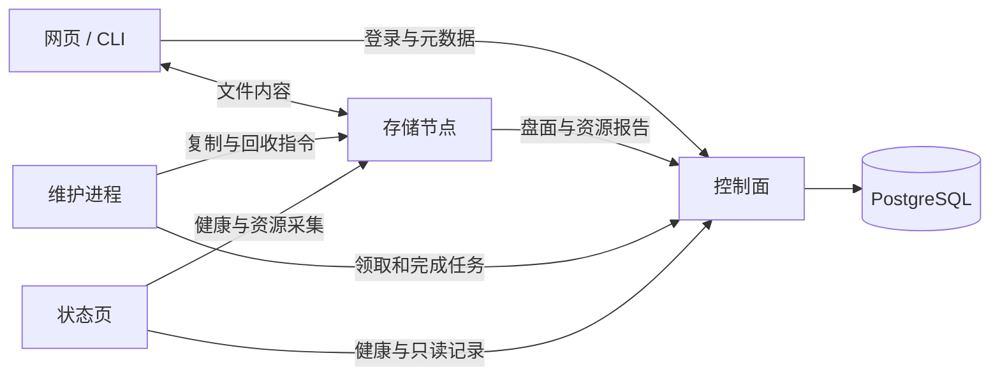

# Yuki Disk

Yuki Disk 是可部署在多台机器上的多用户网盘，提供角色隔离、文件与文件夹管理、历史版本、回收站、内容去重、多个存储副本和后台故障修复。网页和命令行直接与存储节点传输文件；控制面只处理身份、目录、版本和调度元数据。

支持目录存储和固定容量单文件容器，可按容量、传输负载和访问热度分配副本。普通用户可以分享自己的单文件版本，管理员可以据用户授权配置独立机器下载接口。服务器现有目录可只读接入指定存量账号。独立状态页匿名展示经过聚合的健康和容量指标。

## 组件

| 仓库 | 用途 | 运行依赖 |
|---|---|---|
| [control](https://github.com/SjLvrIAGay2/yuki-disk/blob/control/README.md) | 登录、目录、版本、授权、调度和任务状态 | PostgreSQL 16 |
| [node](https://github.com/SjLvrIAGay2/yuki-disk/blob/node/README.md) | 保存、校验和传输块，读取服务器目录 | 满足持久化要求的本地文件系统 |
| [maintenance](https://github.com/SjLvrIAGay2/yuki-disk/blob/maintenance/README.md) | 执行副本修复、迁移和回收 | 控制面及节点 |
| [cli](https://github.com/SjLvrIAGay2/yuki-disk/blob/cli/README.md) | 命令行上传、下载和文件管理 | 控制面及节点 |
| [web](https://github.com/SjLvrIAGay2/yuki-disk/blob/web/README.md) | 网盘网页、预览和传输队列 | Node.js 24，控制面及节点 |
| [status](https://github.com/SjLvrIAGay2/yuki-disk/blob/status/README.md) | 独立公开状态页和受保护的运行详情 | Node.js 24，被监控服务 |

各组件可独立构建和部署。PostgreSQL 是元数据唯一权威；节点磁盘保存文件内容。控制面和维护进程都不代理文件字节。web 与 status 的构建使用相邻 yukiUI 仓库的编译包，运行时无需 UI 源码。



## 部署要求

- 运行基线为 Linux amd64 和 PostgreSQL 16。构建使用 Go 1.27、Node.js 24 和 Python 3。控制面可连接独立的 PostgreSQL 16 服务器。

- 默认两个副本，需准备至少两台处于不同故障域的存储机器；也可显式选择单副本，但不具备节点故障冗余。需要冷热分层时，可采用两个 hot 和两个 cold 节点。
- 数据盘使用本地文件系统：Linux 的 ext4、macOS 的 APFS、Windows 的 NTFS。各平台使用原生文件锁、目录提交和物理预分配；失败即拒绝提交，不忽略刷盘错误，不把预分配降级为稀疏文件。块存储不能放在 SMB/NFS 共享、同步盘或稀疏宿主镜像中。只读外部目录与块存储根分离。
- 为控制面、节点、网页及状态页准备 HTTPS 域名、证书和可达端口，所有服务器保持时间同步。客户端必须能访问节点；公开播放和只读目录下载必须具有可达的节点 HTTPS 入口。
- PostgreSQL、证书签发、DNS、防火墙和备份介质由部署环境提供。PostgreSQL 高可用需单独配置。

## 获取与构建

主分支用 Git 子模块锁定六个组件，同名分支保存各组件的独立源码。网页和状态页使用 `ui-dist` 分支提供的编译包。以下命令从同一父目录准备项目和相邻的 `yukiUI`。

```bash
git clone --recurse-submodules https://github.com/SjLvrIAGay2/yuki-disk.git
cd yuki-disk
git clone --single-branch --branch ui-dist https://github.com/SjLvrIAGay2/yuki-disk.git ../yukiUI
ui_revision=$(python3 -c 'import json; print(json.load(open("ui-source.lock.json"))["distribution_revision"])')
git -C ../yukiUI checkout --detach "$ui_revision"

for unit in control node maintenance cli; do
  (cd "$unit" && mkdir -p bin && go build -trimpath -o "bin/$unit" .)
done
(cd web && npm ci --ignore-scripts && npm run build)
(cd status && npm ci --ignore-scripts && npm run build)
```

目录布局为 `yuki-disk/web`、`yuki-disk/status` 与相邻的 `yukiUI`。两个前端通过 `file:../../yukiUI` 安装编译包，安装时使用 `install-links=true`。构建逐文件核对编译内容的 SHA-256 摘要。升级 UI 时，按主仓库的版本锁更新相邻目录，并重新执行两个组件的 `npm ci`。

## 配置数据库与集群

### 1. 准备 PostgreSQL

创建专用角色和数据库，交互输入独立数据库密码：

```bash
sudo -u postgres createuser --pwprompt yukidisk
sudo -u postgres createdb --owner=yukidisk yukidisk
```

应用角色需要在该数据库的项目 schema 中创建、修改表。不要与其他应用共用 schema。远程连接使用 `sslmode=verify-full` 并配置可信 CA；本机回环连接可使用 `sslmode=disable`。控制面首次启动会自动执行数据库迁移。

### 2. 生成私有配置

```bash
umask 077
cp deploy/topology.example.json topology.json
# 编辑 topology.json，填写实际域名、监听地址、证书、数据路径和数据库 DSN。
python3 scripts/generate-config.py --topology topology.json --output private-config
```

[拓扑示例](deploy/topology.example.json) 中所有名称和数据库密码均须替换。不同机器可以使用相同监听端口；同机运行多个服务时必须分别配置端口和数据目录。

生成器为每个节点及各类服务身份生成独立随机密钥，输出目录必须不存在。生成结果如下：

| 文件 | 安装位置 / 用途 |
|---|---|
| `control.json` | 控制面机器 `/etc/yukidisk/control.json` |
| `<节点ID>/node.json` | 对应节点机器 `/etc/yukidisk/node.json` |
| `maintenance.json` | 维护机器 `/etc/yukidisk/maintenance.json` |
| `cli.json` | 用户私有客户端配置，包含网盘登录密码 |
| `web/config.json` | 唯一公开配置，部署到网页 `dist/config.json` |
| `web-server.json` | 网页机器 `/etc/yukidisk/web-server.json` |

状态页配置按 [status README](https://github.com/SjLvrIAGay2/yuki-disk/blob/status/README.md) 单独创建。只读目录和 P2P 也需要按下文补充生成后的配置。已部署集群应修改并保留原配置与密钥，不要通过重新生成配置来重启或扩容。`topology.json` 和整个私有输出目录均应保存在受限位置，不提交到 Git，也不复制到静态目录。

### 3. 安装服务

在每台服务机器创建服务账户和目录：

```bash
sudo useradd --system --user-group --home-dir /var/lib/yukidisk --shell /usr/sbin/nologin yukidisk
sudo install -d -o root -g yukidisk -m 0750 /opt/yukidisk /etc/yukidisk
sudo install -d -o yukidisk -g yukidisk -m 0700 /var/lib/yukidisk
```

账户已存在时无需再次创建。通过可信管理通道把二进制、对应配置和证书送到各机器。以下为控制面安装示例，源路径按实际文件位置替换：

```bash
sudo install -o root -g yukidisk -m 0750 control/bin/control /opt/yukidisk/control
sudo install -o root -g yukidisk -m 0640 private-config/control.json /etc/yukidisk/control.json
sudo install -m 0644 deploy/yukidisk-control.service /etc/systemd/system/
sudo systemctl daemon-reload
sudo systemctl enable --now yukidisk-control
```

节点和维护进程分别使用 `node/bin/node`、`maintenance/bin/maintenance`，以及[节点服务](deploy/yukidisk-node.service)、[维护服务](deploy/yukidisk-maintenance.service)。节点使用自己 ID 对应的 `node.json`，数据目录归 `yukidisk` 所有，权限为 `0700`。自定义数据路径时同步调整节点 systemd 的 `ReadWritePaths`；只读导出目录还需向该账户授予读取和目录遍历权限。

证书路径必须和配置一致，私钥只允许服务账户读取。服务示例启用了 `ProtectHome=yes`，不要把配置、证书或数据放在用户 home 中。默认示例监听 8443；非 root 服务若需监听 443，可改用受控反向代理或明确配置绑定特权端口的权限。

按 PostgreSQL → control → node → maintenance 的顺序启动。多控制面实例连接同一数据库并使用一致配置与密钥；维护可以多实例运行，控制面只授予一个有效执行租约。

### 4. 部署网页与状态页

网页机器安装 Node.js 24，并将 `web/server.mjs`、`web/telemetry.mjs`、`web/admin-status.mjs`、`web/runtime-logs.mjs` 和整个 `web/dist/` 复制到 `/opt/yukidisk/web/`。用生成的 `web/config.json` 覆盖 `/opt/yukidisk/web/dist/config.json`，将 `web-server.json` 安装到 `/etc/yukidisk/`，配置私有 `statusService` 为独立状态服务的 HTTPS origin，随后启用[网页服务](deploy/yukidisk-web.service)。文件与目录须对服务账户可读。

```bash
sudo install -m 0644 deploy/yukidisk-web.service /etc/systemd/system/
sudo systemctl daemon-reload
sudo systemctl enable --now yukidisk-web
```

公开配置只含地址、运行模式和可选 P2P broker 白名单。控制面及各节点的 `origins` 必须包含网页的精确 origin（包括非默认端口），不能使用 `*`。网页服务负责 CSP 与每次响应的样式 nonce；不要直接换成没有相应响应处理的静态托管。

状态页独立部署 `status/server.mjs`、`status/server/` 和 `status/dist/`，完整配置及 systemd 示例见 [status README](https://github.com/SjLvrIAGay2/yuki-disk/blob/status/README.md)。它使用独立进程、端口和会话，网盘网页停止不会导致状态页停止。

### 5. 检查与首次使用

```bash
curl --fail https://api.disk.example.com:8443/readyz
curl --fail https://hot1.disk.example.com:8443/readyz
curl --fail https://hot2.disk.example.com:8443/readyz
curl --fail https://disk.example.com:8443/readyz
sudo journalctl -u yukidisk-control -n 50 --no-pager
```

检查所有已配置节点与维护进程；维护健康地址在本机，通过其 `listen` 指定的回环端口访问。使用组织 CA 时安装信任根或为 curl 指定 `--cacert`，不要禁用证书校验。就绪成功只表明服务可用，不能替代实际上传和下载检查。

首次管理员凭据位于私有 control 配置的 bootstrap_admin，仅用于初始化，登录后进入系统管理。普通用户使用账号和密码进入网盘，CLI 仅接受普通用户。生成器为 user 与 admin 创建不同的随机凭据；初始化后移除 bootstrap_admin。命令行可先上传一个文件，再下载并比较内容：

```bash
chmod 0600 /path/to/cli.json
cli/bin/cli -config /path/to/cli.json upload ./photo.jpg photos/photo.jpg
cli/bin/cli -config /path/to/cli.json ls photos
# 使用上传响应中的 version_id；目标文件必须尚不存在。
cli/bin/cli -config /path/to/cli.json download VERSION_ID ./saved-photo.jpg
cmp ./photo.jpg ./saved-photo.jpg
```

## 文件、版本与公开访问

同一路径可保存多个版本。移动保留历史；复制只复制最新活动版本并复用内容块。回收站默认保留 7 天，恢复保留版本；原目录不可用时恢复到最近可用上级，同名自动编号。单独删除版本具有自己的恢复期限。永久删除会提前结束恢复窗口，释放引用后仍需等待默认 24 小时的块回收延迟。

文件与目录按账号隔离。普通用户从文件操作创建固定版本、有限期限的分享；链接进入独立匿名分享页，可选择访问凭据。API 分享由文件所有者先创建授权，管理员仅凭授权编号签发受限应用下载凭据，不能隐式浏览所有用户文件。旧目录公开和公开播放链接升级后明确返回 410，原 visibility 数据保留供迁移盘点，不继续提供匿名权限。

只读服务器目录先在节点配置 `exports` 白名单并重启，再由管理员在网页“目录挂载”中选择来源、授权给指定普通用户。控制面旧 `mounts` 配置仅保留首次导入兼容，已导入授权以 PG 为准。具体示例见 [node README](https://github.com/SjLvrIAGay2/yuki-disk/blob/node/README.md#只读服务器目录) 和 [control README](https://github.com/SjLvrIAGay2/yuki-disk/blob/control/README.md#账号删除与目录挂载管理)。外部文件不导入块库，不享有托管文件的历史版本、去重、回收站或副本修复，需单独备份。

用户分享和机器 API 下载通过 HTTPS 直接连接节点，控制面只发清单及授权。撤销立即阻止后续授权；已发节点能力最多有效 60 秒，已开始的单块可完成，已下载字节无法追回。只读挂载暂不参与分享，详情见 [control README](https://github.com/SjLvrIAGay2/yuki-disk/blob/control/README.md#两类文件分享)。

## 可选浏览器 P2P

浏览器可通过 WebRTC 直连节点侧 yukiNAT agent，失败后使用独立 TURN relay。访问者无需安装客户端。需要额外部署独立 yukiNAT 的 broker、relay 以及各节点侧 agent；网盘与它们通过协议连接。

1. 在 broker 的完整配置中加入网页 origin、独立的 issuer 身份、agent 身份及 `browser:true` 服务。例如 issuer 的 `id` 为 `disk-control`、`role` 为 `issuer`、`services` 为 `["node-a-web"]`，服务为 `{"id":"node-a-web","agent":"node-a-agent","browser":true}`。每个身份使用独立随机密钥，TURN secret 也单独生成。
2. agent 配置固定节点映射：`{"service":"node-a-web","http":{"origin":"https://node-a.example.com:8443","methods":["GET","PUT"],"prefixes":["/v1/blocks/"],"max_bytes":4194304}}`，加入其 `mappings` 数组。agent 必须信任节点证书，不开放内部管理路径。内部 PKI 可在 `http` 中设置绝对路径 `ca_file`，只为该映射加载 PEM 信任包，继续验证主机名；配置到同机节点的 `https://127.0.0.1:18444` 时证书须包含该 IP。不得关闭校验或把本机映射改成经公网隧道回流来冒充直连。
3. 控制面配置加入 `p2p: {"broker":"https://nat.example.com:8443","identity":"disk-control","key":"替换为独立随机密钥"}`，对应 `nodes` 项加入 `p2p_service:"node-a-web"`。这些片段需要合并到各服务完整配置，不能独立启动。
4. 网页 `dist/config.json` 加入 `p2p_brokers:["https://nat.example.com:8443"]`，重启控制面及网页服务。broker/agent 需支持 `http3` / `yukinat.http.v3`；对应版本信息在 [nat-source.lock.json](nat-source.lock.json)。yukiNAT 本身的监听、证书和 TURN 配置按其随附说明设置。

网页设置中选择自动或常规连接。未发送应用字节前的 P2P 建连失败可回退 HTTPS；已发送的请求由原传输流程重新获取授权并重试。连接身份短期有效，仅保存在内存。agent 属于可信数据面，浏览器到 agent 为 DTLS，agent 到节点为固定 HTTP(S) 连接。

## 日常运维与恢复

通过 `systemctl restart yukidisk-<服务>` 重启，使用 `journalctl -u yukidisk-<服务>` 查看日志。控制面、节点和网页收到 SIGTERM 后最多排空 10 秒；维护停止在途请求，未完成任务到期后可由有效执行者接管。

`/healthz` 表示进程活性，`/readyz` 表示组件就绪。Go `/metrics` 与各服务 `/statusz` 要求独立 `X-Yuki-Monitor` 凭据并限制监控网络；凭据未配置时拒绝采集。匿名用户只访问 status `/api/status` 白名单投影。远程 status 采集维护进程时，通过受控 HTTPS 代理访问回环健康端口，不直接暴露维护 HTTP 端口。

升级前备份数据库、节点完整数据根和配置密钥。先升级控制面，再升级节点、维护及客户端；P2P 先升级 broker/agent 再升级网页。数据库迁移只向前，旧程序可能拒绝新数据库；回滚需恢复匹配版本的程序与整套备份。

一致备份流程：停止维护，停止接收客户端操作并排空控制面与节点，使用受控数据库备份身份执行 `pg_dump -Fc` 导出全部归属数据，保存所有节点的完整数据根、配置和密钥，标记为同一批次。启用强制 RLS 后，应用数据库身份不适合全量导出；不要关闭 RLS，应使用独立备份身份或本机 PostgreSQL 管理身份。节点备份包含块、容器、格式标记、墓碑和防重放记录，不能只复制运行中的容器。将备份保存到独立介质，再按控制面、节点、维护的顺序恢复服务。

恢复时先停止全部服务，恢复同批次数据库、节点目录与密钥，修正权限后启动，等待盘面对账并检查副本健康。不要仅回滚数据库而继续使用更新的数据盘和删除队列。多副本不能替代备份；整个副本集合都丢失时无法从哈希恢复文件。

## 接口与一致性约定

P2P 页面连接使用下文“页面内 P2P 连接复用”的 v3 契约；仅改变通道生命周期，文件能力、会话撤销及存储一致性边界保持原约定。

维护调度在同一 PostgreSQL 序列化事务内批量读取任务冷却/执行状态和副本位置，按块及代际形成仅限本轮的视图。每个块本轮只规划一次；视图不跨事务缓存，保留五分钟失败冷却、签名资源新鲜度、逐项空间预留和代际栅栏。禁止将批量读取改为脱离事务的调度依据。

运行日志对账失败可细分为 `reconcile_timeout`、`reconcile_cancelled`、`reconcile_control_auth_rejected`、`reconcile_control_conflict`、`reconcile_control_rate_limited`、`reconcile_control_unavailable`、`reconcile_control_rejected`、`reconcile_connection_closed`、`reconcile_network_failure`。仅接收这些固定代码，未知原因仍为 `reconcile_failed`；不发送错误正文、地址或令牌。升级顺序为 control 白名单、web 标签、node 生产者；旧生产者保持兼容，保留期限和重试序列规则不变。

节点就绪状态来自最近完成的对账快照，健康读取不等待存储操作锁。初始状态、对账失败以及超过 30 秒未完成成功对账均为未就绪；监控快照不参与文件授权或副本完整性判定。status 继续使用独立监控鉴权和固定目标缓存采集，节点就绪不等于全部公网访问路径均可用。

web 普通分块与挂载范围下载共用有界滑动窗口，顺序写入后立即补充新请求。默认按有效下载吞吐量和重试反馈在 1..6 个处理任务内自动调节，设置可关闭；64 MiB 及以上自动下载从 6 开始，较小文件从所选强度开始，最短 0.5 秒、至少两块完成后试探增加两个位置，无收益退回、失败减半。已签发且在途的有效请求不因窗口缩小而强制取消。挂载授权只合并当前窗口中同一轮准备好的请求，不缓存或复用单次能力，不延长其期限；失败重取授权，范围身份、长度及版本校验不变。P2P 下载连接按需每节点最多 6 条，上传取连接仍受每节点 3 个活动租约限制，每标签页全局最多 12 条；控制面仍仅处理授权元数据。无需服务端协议或数据库迁移。

web 的 CSP 响应头为脚本与样式分别生成每响应独立的随机 nonce，保留同源脚本限制及 HTML 禁止缓存。可信 CDN 的检测脚本可复制脚本 nonce；不允许无 nonce 的内联脚本，不以 `unsafe-inline` 或固定哈希解决 CDN 动态脚本报错。代理须保持响应头与正文匹配，详见 web README；此机制不改变网盘会话或节点授权。

网页文件列表读取既有分页接口后按名称、大小或修改时间排序，文件夹始终在前，前端不改变服务端归属检查或游标语义。下载沿用既有普通文件、挂载文件、分享授权及完整性校验；客户端保存改为浏览器默认下载管理器，不要求用户选择位置。具备 OPFS 与 Web Locks 时使用有界配额的本机暂存，能力不足时使用最多 256 MiB 的内存回退。速度与剩余时间是客户端近期有效文件字节的估计，不作为调度、配额或持久化提交的依据；详细行为见 web README。

### 挂载文件范围下载与控制面固定连接

普通用户的挂载下载清单可在 `source` 中声明 `node`、`p2p`、`ranges:true`。客户端使用独立 `POST /v1/download/{mount-version-id}/ranges` 提交 `{size,offsets}`：正整数总大小不超过 2^53-1，一次 1–6 个不重复且按 4 MiB 对齐的起点。服务端校验登录角色、所有者和 PG 当前目录授权，返回每段的 `offset,size,revision,range,target`；末段可不足 4 MiB。控制面不读取文件字节。

每段能力用途为 `file-range`，绑定所有者、目录授权、节点、路径、修订、总大小和精确字节范围，60 秒有效、单次使用。节点 `GET /v1/content/range` 必须同时携带 Bearer 和完全匹配的单段 `Range`，拒绝 `If-Range`、空范围、多范围、超过 4 MiB 及与整文件能力混用。节点签名回查 PG 后检查真实文件大小、修订和路径边界，持久消费 nonce，返回 206、ETag、Content-Range。每次源读取前后仍验证修订；缓冲不跨请求缓存文件。失败重试申请新的单次能力，最终客户端只在全部范围、长度及修订匹配后完成下载，失败中止输出。

撤销目录授权、停用/删除账号后，新的节点回查失败；此前已获准且开始读取的单段可完成，下载到用户端的字节不能追回。源文件变化导致新请求或读取失败；文件身份不变的原地修改仍依赖操作系统修订语义。旧清单、空文件、旧网页和 CLI 保留原整文件 HTTPS 协议。agent 映射只增加本机 `/v1/content/` 前缀，单响应上限仍为 4 MiB，不开放导出目录管理接口。

节点可同时配置 `control_address`（固定 IP:端口）与 `control_ca_file`（绝对 PEM 路径），`control` 必须为 HTTPS。只对该控制面主机定向拨号，仍按 URL 主机名验证证书及请求签名；禁止重定向，不改变复制源、broker 或系统证书信任。字段均需重启，不热切换。元数据专用代理仅开放既有签名内部路由，不转发文件内容。未设置时沿用原控制面连接；回滚节点配置需同时恢复原 `control` 地址。

### 原生 P2P 传输边界

控制面可在 `p2p` 中配置 `issuer_url` 和 `issuer_ca_file`，通过固定内部 HTTPS 地址申请短期连接身份；`broker` 仍是返回给浏览器的公开协商地址。CA 文件必须为绝对路径的 PEM，仅用于该 issuer 的证书链验证，仍校验主机名、不跟随重定向，配置变更需重启控制面。未配置内部地址时继续使用 `broker`。申请前验证普通用户会话，在数据库事务外等待 broker，返回前再次验证同一会话的有效性、账号状态和角色；申请期间的撤销、禁用、凭据重置或角色变更不能取得返回凭据。短期连接身份不替代逐块文件能力授权。

节点完成上传字节、完整哈希及持久化提交后，可签名调用 `POST /internal/v1/upload-receipt {upload_id,hash,size,generation}`。控制面在同一 PostgreSQL 序列化事务中应用增量副本报告和上传证明，任一校验失败均回滚；重复回执可安全重试，文件提交仍要求完整副本数与所有权证明。节点物理互斥、持久代际栅栏及全量盘点边界不变。升级顺序为控制面先、节点后；旧节点原报告/证明接口保留。新节点仅在新回执入口返回 404 时兼容旧两步接口，超时或其他不确定失败交由原上传身份重试，不提前宣告成功。

后台复制在鉴权及首次任务许可后，于物理锁外接收一个不超过 4 MiB 的块；每节点最多一个复制接收。完整校验字节后重新持物理锁、向 PG 复核原任务租约/执行者栅栏及当前代际，再检查本地持久代际并提交原后端。过期执行者、删除期间到达的数据或损坏字节不得写入；未提交的内存字节在崩溃后丢弃。GET 在持锁鉴权、防重放、读取并验证完整块后释放物理锁再发送不可变字节，每节点最多八个响应缓冲区。已读取的授权响应可以在源块删除后完成；新的请求仍需有效能力与当前物理副本。慢接收者不阻塞其他块的物理操作，全量盘点与实际写入/删除仍共享原互斥边界。

浏览器 P2P 仍逐请求携带节点能力凭据，不能用协商身份替代文件授权。broker 只交换协商元数据；独立 TURN 只转发 DTLS 密文。agent 的服务映射固定到本机节点的块接口与有界挂载读取前缀，并校验内部 HTTPS 证书。独立 yukiNAT 的映射字段 `ca_file` 只扩展该映射的证书信任，不改变系统、broker 或其他服务的信任；配置必须使用绝对 PEM 路径且目标为 HTTPS。`ice_port_min/max` 只限制 agent/client 的本地候选端口，不保证 NAT 后的外部端口范围或直连成功。

传输结果必须区分 direct、relay 与常规 HTTPS。只有完整上传提交与下载内容校验能证明可用，broker 健康检查和 agent 进程状态不能代替传输验收。停用 P2P 可移除 control 的 issuer/节点服务映射与 web 的 broker 白名单后重启对应服务；已有连接按其期限回收，节点授权和常规 HTTPS 保持原契约。恢复旧配置前需核对期间其他配置变更，不能直接覆盖当前配置。

### 原生平台存储

status 的公开路径由其 `publicPath` 启动配置声明；反向代理保留路径，应用将路径根重定向到带尾斜线地址。同一编译产物可由不同实例分别发布到两个 origin/路径，每个实例保持精确 origin 校验和有界采样。status 的控制面地址、监控目标及 web 的 `statusService` 独立配置固定基础路径，禁止在客户端指定目标或在消费者代码中硬编码 `/disk`。公开路径变更必须同步更新代理、消费者和兼容会话 Cookie 路径；私有详情仍逐次校验管理员身份。

平台适配仅负责文件系统原语和资源采集，不改变块布局、签名、代际、互斥、任务租约与 PostgreSQL 权威。容器格式和描述符提交顺序保持一致；跨机器搬移数据仍需要明确迁移，不能直接更换节点身份或绕过根目录格式检查。

Linux 使用 `flock`、`fallocate` 和 `fsync`；macOS 使用 `flock`、`F_PREALLOCATE` 与 `F_FULLFSYNC`；Windows 使用 `LockFileEx`、`FileAllocationInfo` 和可写目录句柄的 `FlushFileBuffers`。进程锁关闭或进程退出后由操作系统释放。只读目录按持有的目录句柄逐级打开并拒绝符号链接/reparse point，文件修订绑定文件身份和修改状态。

平台未提供或采集失败的指标省略，由状态页显示未知，不能填零。操作系统权限独立于网盘角色；服务账户需要其数据目录的读写和持久化权限，外部目录仅需读取权限。Linux systemd 示例不能直接用于 Windows/macOS，原生启动与权限说明见各模块 README。

### 运行日志与独立节点配置

管理员可点击运行日志事件查看来源、级别、事件代码、发生/接收时间和合并次数，以及该事件的固定诊断说明。已有日志没有保存的底层异常不会被补造或回显。配置应用表按控制、维护、网页、状态页或所选存储节点服务汇总；部分应用、失败和未收到报告分别显示。节点根独占进程的历史报告在新报告出现且旧报告超过 20 秒后标为 `superseded`，仅参与历史说明；同时新鲜的报告仍全部参与判断，最新报告失联则保持过期状态。其他可能多实例运行的服务不据单个成功报告推断全部成功。应用报告自动刷新，表单草稿不被后台刷新覆盖，内部 CAS 版本仍用于并发保护。

各模块缓冲运行事件并周期上传；只接受事件码白名单，不包含文件块成功操作、URL、文件名、凭据或原始异常。control 自写 PG，node/maintenance 使用既有签名，web/status 以独立 `log_keys` / 私有 `logKey` 签名调用 `POST /internal/v1/logs`；该身份只能写日志。CLI 仅以普通用户会话调用 `POST /v1/client-logs`，其记录标为客户端自报。两接口 JSON 为 `{stream,policy_version,entries:[{sequence,level,code,occurred_at,count}]}`，stream 为 48 位随机十六进制、sequence 单调增加，每批最多 100 条/64 KiB，响应 `{ack,policy}`。重试保持 stream/sequence/内容，内部 nonce 每次更新。PG 高水位防重，保留记录被裁剪也不重新入库；时间超过 7 天拒绝，高水位保留 8 天。

管理员 `GET /admin/v1/logs?before=&level=&module=` 分页最多 100 条；`GET/POST /admin/v1/log-policy` 用版本 CAS 完整提交 `{version,info_limit,warning_days,upload_seconds,min_level}`。默认 info 最新 1000 条，warn/error 入库后 30 天，范围分别 0..100000 和 1..365 天；默认上报 10 秒（2..60）。策略缩短立即清理，静默时每分钟清理。日志使用独立短 PG 事务和来源限流，不占文件/任务全局锁；安全审计、任务状态和一致性事件按原契约保留。默认策略的服务确认版本及失联状态在查询中单列，不能把提交成功当作所有服务生效。

`GET /admin/v1/node-configurations` / `POST /admin/v1/node-configurations/{id}` 管理每节点完整设置和版本。字段为 `read_bandwidth_bps`、`write_bandwidth_bps`、`reserve_bytes`、`resource_interval_seconds`、`log_upload_seconds`、`log_min_level`；读写预算只是调度权重。调度列与配置版本在原 PG 权威事务内一起更新，已有预留/任务/能力不改变。节点签名 `POST /internal/v1/node-configuration {instance_id,applied_version,state}` 每 3 秒取 `{version,settings}` 并报告应用状态，不能选择其他节点身份；接口分别报告目标与生效版本，页面只显示应用状态。资源采样 1..5 秒继续满足既有新鲜度约束。PG 值优先于启动种子，无环境变量覆盖。根、格式、身份、连接、密钥及容量不由该接口修改。

升级先停止旧服务并备份 PG、完整节点根和私有配置，执行新版 control `-migrate-only` 至 schema 17，再升级独立消费者。16/17 不修改旧文件归属和物理数据；node 首次启动种子从 control 节点预算导入，之后旧 JSON 不覆盖 PG。web/status 新增独立日志密钥需和 control 配套，未配置时仍可运行但不集中上报该模块日志。缓冲最多 1000 条，相邻事件可合并，网络失败退避、关闭时限时排空；崩溃可能丢失尚未送达的记录，不能替代安全审计。

`scripts/generate-config.py` 生成配对的私有日志凭据：web 已包含于 `web-server.json`；`status-log.json` 是供合并到 status 私有服务器配置的 `logKey` 片段，不能放入静态目录。示例中的 development-only 值仅供回环开发，生产拒绝此类日志凭据。

本节是各独立组件共同遵循的协议语义；各组件 README 说明自身接口与配置。控制面 v1 接口采用 UTF-8 JSON、`snake_case` 字段和严格输入校验；不兼容的语义变更需要新的协议版本。

### 文件与授权

- 内容使用 SHA-256 小写 64 位十六进制哈希，块长 4 MiB，末块可短，空文件无块；单文件最多 10000 块。副本数由 control 启动配置 `replicas` 决定，默认 2，允许显式设置为 1，必须是不同节点上的完整当前代际副本。单副本时不同文件块可分配到不同节点，唯一副本丢失无法恢复；空间预留、完整内容校验、归属证明和提交条件仍然生效。修改副本数需协调重启全部 control 实例，降低后维护按现有栅栏流程回收多余副本，不能通过恢复配置宣称冗余已恢复。消费者按计划返回的 targets 传输，不硬编码双副本。
- 文件路径为相对路径，最多 1024 字节；禁止绝对路径、空段、`.`、`..`、反斜线、控制字符及 `<>:"|?*`，各段不以点或空格结尾。
- 配置 origin 为精确的 `scheme://host[:port]`，无尾斜线、路径、查询、片段或凭据。生产使用 HTTPS，`development=true` 仅允许回环 HTTP。应用配置来自显式 JSON 文件，无环境变量覆盖。
- `POST /v1/session {username,password,client}` 返回 300 秒访问凭据和 PG 权威角色。web 长期会话使用 HttpOnly、生产 Secure、SameSite=Strict Cookie，绝对 30 天、空闲 7 天；精确 Origin 与 X-Yuki-CSRF 防护，部署须同站 HTTPS。刷新摘要及撤销在 PG 持久化，轮换有固定 30 秒重试窗口。退出、禁用、重置和角色修改按会话/账号撤销，旧令牌不能续权。CLI 仅允许普通用户，管理员令牌访问网盘接口返回 403。
- 文件、目录、回收站、上传与操作幂等按 PG owner_id 校验，强制行级策略与请求事务共同限定范围。管理员管理账号、目录挂载授权、API 应用、运行状态及白名单配置，无隐式用户文件读取权。删除账号立即停用、撤销会话和分享，保留数据 30 天可恢复；到期复用原引用回收和节点 GC，不删除挂载源文件。最后一个可用管理员受保护。首次管理员显式配置，存量数据必须指定唯一 legacy_username 后事务迁移，详见 [迁移步骤](https://github.com/SjLvrIAGay2/yuki-disk/blob/control/README.md#多用户初始化与归属迁移)。
- 上传与批次操作使用 8..128 字节 `Idempotency-Key`。相同键和请求复用结果，改正文返回 409；上传重试与响应丢失重试保留原键。提交必须满足全部块的完整副本要求，重复提交不新增版本或引用。
- 节点块能力编码为 `base64url(JSON).base64url(HMAC-SHA256)`，无 padding，签名作用于第一段原始 ASCII。正文绑定 `v:1,purpose,node,hash,size,generation,exp,jti`，上传可额外绑定 `upload_id`，有效期通常为 60 秒。节点持久化防重放；失败重试须重新领取能力。跨用户去重需节点完整验证字节后签名上报 `/internal/v1/upload-proof`，提交要求所有权证明及完整副本；不能仅凭哈希或 HEAD 获得文件。
- 块 PUT/GET 在能力校验成功后使用最多 120 秒的读写截止时间；60 秒能力期限决定是否允许开始请求，不中断已经获准的单块。元数据及请求头维持短超时，任务租约不随此前台传输期限延长。CLI 块请求最多 120 秒；遇到 `403 capability_rejected` 时保留原上传幂等身份重新规划，最多八轮退避，不重试其他权限拒绝。部署代理需允许此传输窗口，禁止自动重放写入。
- 客户端元数据与块请求禁止重定向。用户分享 `/v2/shares`、公开访问 `/public/v2/shares`、管理员应用配置 `/admin/v1/applications` 和机器下载 `/api/v1/files` 具有独立入口与凭据。只支持固定版本下载，创建幂等、授权限流和审计均在 PG。移动不改变分享版本，新增版本不替换，回收/永久删除永久撤销且恢复不重启授权；禁用所有者期间不可用。旧 `/public/v1` 链接返回 410，不扩张原授权。
- API 来源授权及应用可以指定 60 秒至 36500 天，或 `permanent:true,expires_in:0`；永久用 `expires_at:null` 表示，仍受所有者状态、版本状态及撤销约束。永久应用必须引用永久来源授权，有限应用不能超过来源期限。用户公开分享仍最长 30 天。
- 只有管理员可经 `/admin/v1/exports` 浏览节点显式配置的只读导出目录元数据，经 `/admin/v1/mounts` 创建来源并授权给普通用户的空闲虚拟路径。普通用户只能读取已授予自己的目录，不能创建挂载。挂载能力绑定用户、授权、文件修订及节点，节点实际读取前回查 PG；撤销后尚未开始的请求拒绝，已经开始的整文件请求可完成。取消授权、删除用户或删除挂载均不删除外部源文件。宿主机任意路径不能通过网页开放。
- control 可热改回收期限、上传期限、两类分享表单默认期限、登录/分享验证上限和分享下载授权上限，共六项。完整校验与版本 CAS 原子提交 PG，各实例每 2 秒独立应用并报告目标/生效版本，失败保留旧快照，失联显式显示。期限只影响新操作；限流从实例应用后的下一请求生效且不清空当前计数。PG 运行值优先于启动 JSON；其他模块配置类别见各 README。根、格式、身份、数据库和密钥不能通过热修改隐式迁移。
- status 匿名接口仅返回整体状态、采样时间及容量/CPU/内存/传输聚合白名单。后台固定目标采样、缓存、超时与来源限流独立于客户端刷新；缺失为 null、过期不视为健康。内部健康诊断与管理鉴权不因公开 status 放开。
- status 公开页无服务详情、维护记录或登录入口。web 管理页显示服务详情与集中运行日志；详情通过固定只读 `/admin-status/details` 转发至私有 `statusService`，日志读取 control `/admin/v1/logs`，逐次校验 PG 管理员会话。旧 `/admin-status/events` 仅保留受保护的接口兼容，不作为管理页运行日志来源。代理仅转发 Bearer，不转发 Cookie，不接受任意目标。status 继续独立构建与采集；兼容内部 `status-session` 只读会话，其凭据不能管理系统或读取文件。
- 控制面错误为 `{code,message}`，400 输入错误、401 未认证、403 拒绝、404 不存在、409 冲突或未就绪、410 过期、413 过大、503 依赖或副本不足；409/503 的退避提示不能视为成功。

### 内部身份与物理操作

内部请求使用 `X-Yuki-Identity`、`X-Yuki-Time`、`X-Yuki-Nonce`、`X-Yuki-Signature`。签名为 HMAC-SHA256 小写 hex，输入按以下顺序以 LF 连接，不加末尾 LF：

```text
identity
HTTP_METHOD
URL.EscapedPath()
URL.RawQuery
hex(SHA256(原始正文))
unix_seconds
nonce
```

nonce 为 24 字节随机值的 48 位 hex，时钟窗口为 ±30 秒。`node:<id>` 用于自身盘面与资源报告、任务许可及内容授权查询，不能领取或完成维护任务；`maintenance` 领取、执行并完成维护任务。节点只读 export 元数据接口接受 `control` 身份及该节点独立密钥，不能用于破坏性任务。

所有元数据状态变更在 PostgreSQL 的共同事务串行化边界内完成。位置选择与空间预留同事务提交，资源必须经过节点签名且保持新鲜；带宽预算只作调度权重。节点物理操作持互斥并保存代际栅栏，旧代际写入或删除不能作用于新代际内容。

节点清单每页最多 1000 项，按 snapshot/page 递增，只有 final 页完成才整体应用；中断的清单不能作为删除副本依据。节点重启从持久数据重建报告，完整副本条件不能用一次 HEAD 或健康探测替代。

任务通过 claim → 节点 permit/task → complete 执行；leader 租约 20 秒、任务租约 15 秒，owner/fence 与期限共同约束许可及完成。失败最多尝试 4 次并指数退避，失败后冷却 5 分钟可重新计划。终态任务保留 7 天、事件保留 30 天，两者均受最近 10000 ID 范围限制。

可恢复版本始终持有引用；永久删除与到期回收共同释放引用，通常零引用块经过上传保留期和 GC 延迟。容量压力下可提前回收：完整上传计划因空间不足失败时，PG 保存点完整回滚计划，只提交安全回收调度，仍返回 `503 insufficient_capacity` / `Retry-After: 2`；维护扫描发现新鲜可写节点不足以容纳一个标准块的既定副本数时也会触发。缺少新鲜资源或节点离线本身不触发提前回收。

每轮最多提前调度 256 个块，仅限 available/reclaimable、零引用且无任何版本引用、无有效未提交上传引用、无未确认位置预留、无执行中或排队复制任务的块。内部回收在相同全局 PG 序列化事务内检查全部所有者的引用，不返回用户文件信息。已提交上传留下的 upload_until 和已确认预留不阻止永久删除后的回收；回收站、账号 30 天恢复期和其他用户仍引用的块不受影响。`delete` 任务的 `reason=capacity_gc` 优先于普通排队任务，不抢占执行中任务，失败退避不变。节点仍需签名许可、租约/代际栅栏、物理互斥和持久提交；成功完成后仅移除该节点不高于任务代际的旧预留（migration_trim 不适用）。不能提前计入待释放容量，后续分配仍消费签名的新鲜空间报告。相同内容重新上传遵守新代际规则，旧删除不能删除新数据。永久删除后的已有下载授权不保证内容继续可用，进行中的读取仍与物理删除串行化。副本不足优先修复；迁移先建立并确认新副本，再重新检查健康副本数量后删除多余旧副本。

## 容量与使用边界

网页预览文本上限 2 MiB，图片、PDF、DOCX 和媒体上限 50 MiB。下载默认交给浏览器；支持 OPFS 与 Web Locks 时受本机配额限制，不支持时内存下载上限为 256 MiB，更大文件使用 CLI。文件页统一排序最多 50000 个目录/搜索结果，超出需缩小搜索范围。网页支持基线为现代 Chromium，媒体编码取决于浏览器。

节点盘面对账和完整性校验会消耗磁盘 I/O，启动初检可能较慢。单目录外部文件列表最多扫描 100000 项，超出应拆分目录。状态页显示的是当前采样，无持久历史；同卷节点容量不能简单累加。系统面向个人规模，元数据写事务串行化会限制大规模写入吞吐。内部服务主机及密钥属于可信边界，不提供恶意节点共识。

### 页面内 P2P 连接复用

浏览器使用 `http3` / `yukinat.http.v3`，需先升级独立 yukiNAT broker 和 agent，再升级 web。旧 `http`、`http2` 客户端仍由 agent 按原限制服务；新 web 遇到不支持 v3 的服务会按既有规则使用 HTTPS，不将其显示为直连。

连接按控制端、broker 白名单、节点和登录会话 ID 分区，仅保存在当前标签页内存；访问凭据的正常续期不关闭连接。每节点最多六条连接、上传最多三个活动租约、每标签页最多十二条。预览、普通文件与挂载范围请求共用连接池。空闲每 60 秒在独占通道上发送一个字节 ping 并等待 pong，10 秒无响应关闭，不在后台反复协商。agent 允许 300 秒空闲，后台冻结或网络休眠超过这一时间可使连接失效，后续传输按既有有界重试重新建立。

刷新、离开页面、退出登录及会话恢复失败关闭连接；令牌轮换仅改变后续请求凭据。连接仍受 broker/agent `session_seconds` 较小值约束，v3 最多 86400 秒及 1000000 个请求，达到上限后按需重新建立。通道保活不能续期文件授权，不能把连接身份替代节点能力；每个文件/范围请求仍重新授权，既有撤销及在途传输边界不变。资源占满时可回收空闲连接，故不保证一条物理连接永不更换。
